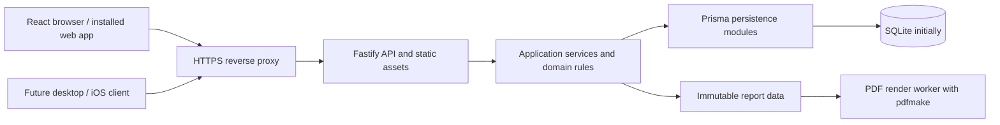

# Timekeeper — Technical Design

Date: 2026-11-10
Status: Design baseline with renderer feasibility validated on both deployment targets.

## 1. Decisions and scope

This design implements [the product specification](specification.md). The product specification governs user-visible behavior; this document governs component boundaries, persistence, calculations, APIs, and deployment. [Discovery](discovery.md) retains the decision history.

| Layer | Decision | Status |
| --- | --- | --- |
| Language | TypeScript, ESModules, tabs | Selected |
| Web frontend | React and Vite | Selected |
| Routing and server state | TanStack Router and TanStack Query | Selected |
| API | Node.js supported LTS and Fastify | Selected |
| Persistence | Prisma 7 with SQLite initially | Selected; exact compatible releases pinned during setup |
| Migration targets | PostgreSQL and MariaDB | Preserve portability; actual transfer tools/rehearsals are optional, very-low-priority future work |
| PDF renderer | Server-side pdfmake 0.3.14 | Accepted after the Pi 4 and x86-64 VPS comparison. [ADR 0002](adr/0002-pdfmake-for-time-reports.md) |
| Tests | Vitest and Playwright | Selected |
| Hosting | Docker Compose, ARM64 and x86-64, HTTPS reverse proxy | Selected; proxy/domain details deferred |
| Future native clients | Same API; evaluate Tauri for desktop and Capacitor/Tauri or native UI for iOS | Direction only; no native runtime selected |

Prisma 7 is the baseline because it documents adapters for all three required databases, including MariaDB through the MySQL provider. Pin Prisma CLI, generated client, and adapter versions together; do not upgrade major versions without rechecking all three targets. The SQLite adapter uses `better-sqlite3`; target adapters are `pg` and `mariadb`. Verify the native SQLite driver's ARM64 build during setup. [Prisma driver adapters](https://www.prisma.io/docs/orm/v7/core-concepts/supported-databases/database-drivers), [MariaDB connector](https://www.prisma.io/docs/orm/v7/core-concepts/supported-databases/mysql).

The accepted persistence tradeoff is recorded in [ADR 0001](adr/0001-prisma-and-portable-persistence.md). No packages have been installed by this documentation task.

## 2. Application shape

Use one repository and one application service, with explicit internal modules rather than independently deployed services. A reverse proxy terminates HTTPS. Fastify serves the compiled frontend and `/api/v1` under the same origin. Vite runs only during development/build.



Proposed repository layout (directories are created during implementation):

```text
apps/
	web/                  React routes, components, forms, query hooks
	server/               Fastify routes, auth, services, persistence, jobs
packages/
	contracts/            API request/response schemas and types
	domain/               Pure time, money, allocation, grouping, identity rules
	reports/              Report data types and renderer adapter
prisma/
	sqlite/               Schema and committed migration history
	postgresql/           Target schema and migration history
	mariadb/              Target schema and migration history (mysql provider)
docs/
	adr/
```

Use npm workspaces and one lockfile initially. Do not introduce a task-orchestration framework. Keep Prisma types out of API responses and frontend imports. Define narrow persistence operations around entries, timers, clients/projects, import batches, and reports; avoid a generic repository framework.

The domain package is independent of React, Fastify, Prisma, and the selected renderer. The server remains authoritative even if the browser uses pure helpers for previews. UI components never query the database directly.

## 3. Frontend and API contracts

### Frontend state

- TanStack Router search parameters represent committed list filters, sorting, and pagination. Forms hold unsaved edits locally.
- TanStack Query caches server data. Include all filter parameters in list/summary query keys. Invalidate affected data after confirmed changes.
- Never optimistically claim timer start/stop or invoice marking succeeded. Show pending state until confirmation; allow safe retries after connection failures.
- Display elapsed timer seconds locally from the server start instant and server-time offset. Refresh on focus/reconnection and poll active timer state every 10 seconds while visible. The display interval performs no database writes.
- A standalone manifest and launcher icons support browser installation. Serve the manifest, fixed-name icons and app shell with revalidation, and hashed static assets with immutable caching. Authenticated API responses use `no-store`. The installed app requires a server connection and uses no service worker.
- Reuse the same responsive interface in future webview clients where appropriate. Authentication, secure credential storage, file downloads, deep links, and platform integrations will need client-specific design.

### Contract approach

Use versioned HTTP JSON endpoints with shared runtime request/response schemas and generated TypeScript inference. JSON Schema with Fastify is the baseline; choose the schema-authoring helper during setup. Publish OpenAPI from route schemas. Treat schema validation and domain validation as separate steps.

IDs are opaque application-generated UUID strings. API timestamps are ISO 8601 UTC strings; local dates use `YYYY-MM-DD`. Integer monetary quantities are serialized as decimal strings so JSON never loses precision. Do not expose Prisma's `BigInt`, driver objects, or internal session records.

| Endpoint family | Responsibilities |
| --- | --- |
| `/auth/login`, `/auth/logout`, `/auth/session`, `/auth/password` | Session lifecycle and password changes |
| `/clients`, `/projects` | CRUD within lifecycle constraints; archive/restore actions |
| `/entries`, `/entries/:id`, `/entries/:id/history` | Filtered list, details, conditional edits, trash, restoration |
| `/timer`, `/timer/start`, `/timer/stop`, `/timer/switch` | Authoritative timer state and atomic transitions |
| `/entries/bulk/preview`, `/entries/bulk/commit` | Explicit selections, version checks, split/mark/delete operations |
| `/reports/preview`, `/reports/pdf` | Shared report scope and asynchronous PDF generation |
| `/imports/clockify/preview`, `/imports/:id/commit`, `/imports/:id/undo` | Staged import, approved commit, guarded undo |
| `/jobs/:id`, `/jobs/:id/download` | Authorized job state and generated artifact download |
| `/exports`, `/settings` | Portable exports and report settings |

These are endpoint families, not final request schemas. Define their payloads alongside implementation without changing the product rules.

Use structured errors with a stable code, human-readable message, field errors when applicable, and request ID. Use 401/403 for authentication/authorization, 409 for state/version conflicts, and 422 for domain-invalid submissions. Never return private entry data in another account's error context.

## 4. Persistence model

The following is a schema blueprint. Each provider has a reviewed Prisma schema and SQL migrations; shared behavior is verified by contract tests rather than assumed from matching model names.

| Record | Important fields and constraints |
| --- | --- |
| Account | UUID, login email, password hash, timestamps; normalized login key unique |
| Session | Hashed opaque token, account ID, creation and absolute expiry; no raw token stored |
| Client | Account ID, name, nullable default rate in öre/hour, notes, archivedAt, revision |
| Project | Account ID, nullable client ID, name, nullable rate override, billable default, notes, archivedAt, revision |
| Entry | Account ID, kind, description, nullable project ID/direct client ID, start/end UTC or local date, integer seconds, billable, nullable assigned rate, amount, completion, invoice metadata, revision, deletedAt |
| RunningTimer | Account ID unique, timer UUID, start instant, description and billing/association snapshot, revision |
| EntryDayAllocation | Entry ID and local date unique, seconds and amount in öre, calculation version; rebuilt atomically on relevant edits |
| EntryHistory | Entry ID, action, timestamp, before/after serialized snapshots, related operation/batch ID |
| ImportBatch | Account ID, status, source format/canonicalization version, staged preview, approved decisions, counts, commit/undo timestamps |
| ImportIdentity | Account/source identity digest and occurrence slot unique, source snapshot, entry link or tombstone, lifecycle state |
| ImportEntryLink | Source identity to entry/descendant links, preserving recognition after splits; links survive ordinary deletion |
| ImportResolution | Incoming fingerprint, matching decision and target identity; remembered conflict decisions |
| ImportChange | Batch ID, affected entry, before/after snapshots and committed revision, identity changes for guarded undo |
| OperationReceipt | Account ID and idempotency key unique, request hash, result snapshot, completion time |
| BackgroundJob | Account ID, kind, status, immutable input/scope, artifact path/checksum, timestamps, error code |
| AccountSettings | Business name, logo asset reference, formatting/report defaults |

Rules enforced by services and constraints:

- Every request scopes reads and writes to the authenticated account, even during single-user operation. Check ownership of related IDs inside the mutation transaction.
- A project entry stores `projectId`, not an independently editable client. A direct-client entry stores `directClientId`; both cannot be populated. Resolve project client through the project relation.
- A single `RunningTimer` row per account avoids provider-specific partial unique indexes for active timers.
- Prefer foreign keys with restricted deletion. Archive referenced client/project records. Retain a minimal entry shell after trash expiry when history/import identities still reference it; it is not restorable through ordinary trash after 30 days.
- Nullable rate override means inheritance; zero is an explicit override. A missing assigned billable rate means incomplete, not zero.
- Invoice number and reference remain text. Invoice date is a calendar date; markedAt is an instant. Invoiced incomplete imports are retained but excluded from financial/report totals until completed through the required unmark/edit flow.
- All entry mutations increment revision and write history in the same transaction. Invoice metadata changes also affect revision and import undo eligibility.
- Use text for domain status values and validate allowed values in contracts/services; avoid provider-native enums. Store snapshots as versioned serialized JSON text; do not make core behavior depend on JSON database operators.
- Index account/date, account/project, account/direct client, invoice filtering, and source matching keys. Do not add a global unique name constraint: duplicate names warn and must remain import-resolvable.

### Provider consistency

Use UUIDs with consistent casing and fixed formats; cap indexed strings to portable lengths. Map descriptions, notes, and snapshots to sufficiently large text types on each provider. Select explicit collations where necessary, but do not rely on a database's default collation for identity or case-sensitive summary grouping.

Group descriptions in domain code using exact trimmed strings. Perform import fingerprinting in domain code. Start with case-insensitive literal description/invoice-number substring search, normalized consistently in application code; for this single-user dataset it may run after scoped candidate retrieval, before pagination. Do not promise scalable full-text search in this release.

The portability test suite must cover Unicode, trailing spaces, nulls, zero rates, date precision, bigint serialization, text capacity, and uniqueness semantics. A clean Prisma generation is not proof of equivalent behavior.

## 5. Time and money

### Representation

Store timed instants at whole-second precision in UTC. Use the same truncation policy for start and stop before computing integer elapsed seconds. Store manual duration-only dates as validated ISO date strings and durations as integer seconds. Audit timestamps may retain finer precision. The browser and server share the Stockholm resolver in `@timekeeper/contracts`, using `temporal-polyfill` 1.0.8 for explicit ambiguous and nonexistent local-time handling.

Resolve calendar ranges in Europe/Stockholm to half-open instant intervals. Enumerate local midnights with timezone-aware calendar arithmetic, never by repeatedly adding 86,400 seconds. Duration-only entries contribute to one date. Keep the timezone/calculation version associated with stored allocation behavior.

### Exact amount and allocation algorithm

Technical baseline: input hourly rates have up to two decimal SEK places and are stored as integer öre/hour. Reject additional precision explicitly rather than silently round it. Use bigint arithmetic for multiplication and division; durations and rates are nonnegative.

For an unsplit, completed billable entry with positive duration `S` seconds and rate `R` öre/hour (incomplete/zero-duration records do not enter this calculation):

- `A = floor((S × R + 1800) / 3600)` öre (round half up).
- Non-billable entries have `A = 0`.
- Let daily segments be ordered chronologically, and `C_i` be cumulative seconds through segment i.
- Define `F(C) = floor((2 × A × C + S) / (2 × S))`.
- Segment i receives `F(C_i) - F(C_(i-1))` öre.

This distributes the already-rounded amount proportionally and deterministically, with `F(0) = 0` and `F(S) = A`. Compute allocations over the whole entry before applying report filters, never re-round a filtered slice. An entry worth one öre split evenly across two days allocates one öre then zero; reporting the days separately still totals one öre.

Persist day allocations transactionally and use them for list totals, reports, and invoice splits. When splitting an entry, child entries inherit the original allocated day amounts rather than independently rounding their rate/duration again. Store split provenance and the preserved amount. A later rate/duration/billability edit to an uninvoiced child recalculates that child and its allocations; description-only edits do not. This deliberate rounding exception preserves totals at split time without hiding subsequent user edits.

Store a calculation version with allocations and cover it in export/migration. Never silently rewrite invoiced historical amounts during a future algorithm change.

## 6. Atomic operations and concurrency

All mutation services own their transaction boundary; repository methods accept its context. Parsing CSV, rendering PDFs, networking, and expensive preview work happen outside write transactions.

- **Start:** insert the unique account timer, returning its server timestamp. Concurrent starts produce a conflict, not a second timer.
- **Stop:** check timer ID/revision, capture a stop instant, create a completed/incomplete entry and allocations/history, remove timer, and record the operation receipt atomically.
- **Switch:** stop and start within the same transaction and use one boundary instant, avoiding an accidental gap or overlap.
- **Edit:** condition the update on ID, owner, and expected revision; zero affected records means conflict. Validate invoice eligibility inside the transaction.
- **Bulk:** preview returns an explicit selection of IDs and revisions, including all-pages selections. Commit rechecks selection, associations, defaults if used, and boundaries; changed state requires a new preview, never silently changes the affected set.
- **Split and mark:** create child entries/allocations, retain original provenance/history, update source identity links, and mark the selected children in one transaction. Reimporting the original source must still recognize the split lineage.
- **Imports:** compare a server-side preview revision/hash at commit and revalidate affected state inside the transaction. Commit all approved changes or none.

Require client-generated idempotency keys for timer transitions and batch commits/undo. Persist the request hash and outcome with the transaction. A repeated key with the same request returns the original result; a different request using that key conflicts. Concurrent duplicate keys must not execute twice. Retain compact receipts in version one; choosing a retention window later requires preserving retry guarantees.

Configure SQLite foreign keys, WAL, a bounded busy timeout, and one application writer process. Retry transient database contention only for transactions whose operation identity is stable, with bounded backoff. Cross-provider tests exercise conflict behavior rather than depending on SQLite's locking to mask races.

## 7. Authentication and files

Use opaque server-side sessions with a 12-hour absolute lifetime. Store the SHA-256 digest of a random 256-bit token and use Secure, HttpOnly, SameSite=Strict cookies over HTTPS. Login replaces any presented active session. Logout revokes the current session. Password change revokes all old sessions and issues a replacement, and local reset revokes all sessions. Session reads leave expiry fixed.

Check the configured origin and a cookie-bound CSRF token for browser mutations, including login. The reverse proxy is trusted only when the immediate peer matches a configured literal IP. Login and current-password verification use separate, bounded per-process attempt counters by normalized email and client address. The account operator guide records dependency pins, work factors, timeout choices, and recovery commands. [Account operator guide](account-access.md)

Session storage remains behind an authentication boundary so future native clients can use a separately reviewed login/token flow. Do not enable unrestricted credentialed CORS in anticipation of native apps.

Store uploads/artifacts under generated server paths, never user-provided paths. Validate sizes and content types; escape descriptions/CSV fields and prevent spreadsheet-formula execution in CSV exports. Use only local approved fonts/logo assets in report rendering. Authorize every job/download by account. Public health checks expose no user data.

## 8. Clockify import design

Separate parsing, canonicalization, matching, review, and commit. Preserve source strings for inspection. Canonicalization is versioned and independent of filenames, row order, local edits, and formatting of the export file itself.

1. Parse named columns, validate format, select user and timezone, and resolve ambiguous timestamps. Parse exact duration seconds. Stage source records without changing work records.
2. Build a canonical row from source user identity, resolved instants, exact duration, client/project/description, and remaining source metadata. Preserve meaningful case/whitespace distinctions; normalize only documented representational differences such as dates and line endings. Hash a stable serialization with SHA-256.
3. Build a weaker candidate key from user/start/end to find possible corrections. It is not unique proof of identity. When timestamps also change, offer manual matching rather than invent certainty.
4. Group identical fingerprints as a multiset. A fingerprint has stable occurrence slots independent of row positions. Default to one accepted occurrence; keeping two establishes two identities. On reimport, default to the previously claimed count within the rows present. Require an explicit increase to add occurrences. A lower count or subset leaves prior claims intact. Show which staged lines will be imported, matched to existing claims or omitted. Choose unused positive occurrence slots for new claims independently of file order.
5. Preview mappings, explicit rates/billability, incomplete rows, conflicts, and exclusions. Source `invoiced` plus non-billable classification is a contradiction to resolve, not a combination to silently commit.
6. Store remembered resolutions and aliases when a corrected source is accepted. Keep-existing also consumes the reviewed source identity so it does not nag on every import. Split/deleted entries remain linked through identity lineage or tombstones.
7. Atomically commit entries, allocations, histories, identities, mappings, batch changes, and receipt. If a preview becomes stale, return a conflict before mutation.
8. Undo checks recorded after-revisions and subsequent invoice actions. Revert unchanged updates, trash newly created entries, and restore identity lifecycle state as one operation. Retain clients/projects. Explicit undo releases the batch's import claims for reimport; ordinary deletion does not.

Clockify file inspection leaves no stored source. When the owner starts mapping, the server stores an account-scoped snapshot of the selected user's rows and unassigned errors for 30 minutes. The final review token is valid for up to 15 minutes within that period. Later staging requests purge expired snapshots and reuse an identical active snapshot until its original expiry. Expiry prevents access before that cleanup runs. Imports allow up to 4,000 source records and 8,000 new day allocations per batch, with a 30-second write transaction timeout. For a duration disagreement, the owner can use the elapsed timestamp interval or import the exact source duration on the Stockholm date of the resolved start. Duration-only import requires complete work fields. An initial invoice mark retains the source flag, including on explicitly accepted incomplete rows.

Approval binds the chosen mappings, source rows, resulting work and current identity decisions. The write transaction rechecks them before creating catalog records, entries, allocations, history and source identities. Successful retries with the original operation key return the stored result even after preview expiry or cleanup. Batch history and identity records retain the approved decisions and source metadata for later reconciliation. Exact row identity uses the selected source user/email and resolved instants, the exact source duration and original metadata. It preserves meaningful case and whitespace, normalizes line endings, and disregards the rounded decimal duration and filename.

Correction review shows saved source values, current local work, and the proposed replacement. Automatic candidates use the weaker user and resolved start/end key. The owner can search imported roots and explicitly link a row whose timestamps changed. Search uses literal Unicode matching and scans up to 64 roots per page, returning up to 20 matches. Review permits up to 100 correction rows, five automatic candidates per row, and 8 MiB of candidate and proposal data. A correction batch can retain up to 8,000 previously saved day allocations for undo.

Keep and update record the incoming source alias against one original occurrence. The original and earlier aliases remain valid. Import separately creates a new occurrence for the incoming fingerprint. A target can resolve one row per batch to keep each selected occurrence's disposition explicit. Keep can remember a correction for an invoiced, incomplete, deleted, or split root. Update requires a completed, active, uninvoiced, unsplit target at the reviewed revision. It applies changed source description or time only. Saved local associations, billability, rate and invoice state stay in place. Review uses the latest accepted alias for the explicitly selected target as its source baseline, including keep decisions. Updates preserve exact before and after work and day allocations, including their calculation versions, for later guarded undo.

Batch undo is a separate confirmed transaction. It trashes unchanged entries created by the batch, restores exact saved fields and allocations on unchanged correction targets, and releases only the batch's source claims and aliases. Clients and projects remain. Later entry revisions, invoice actions, splits, deletions, or dependent aliases block the whole batch. A correction reversal increments the entry revision, so a prior batch remains stale even if the work values match again. A later keep-only alias can be undone without changing the entry revision. An initial source invoice mark is preserved in Trash. The undo records a dedicated history event and leaves manual invoice history intact.

Released claims retain their source metadata for audit. Restoring an undone entry from Trash reclaims its original source occurrence in the same transaction. Restoration is blocked if a reimport has already claimed that occurrence. Ordinary deletion retains its original claim. Replaying a successful undo with its original operation key returns its recorded result.

Use synthetic versions of the supplied structure for committed fixtures. Preserve source payloads in protected import data, not logs. Import cancellation/parse failure creates no work entries. The staged preview can be discarded independently of committed import history.

## 9. Reports and PDF rendering

A single report builder accepts normalized filters and produces immutable, renderer-independent `ReportData`: scope, language, totals, day series, project shares, description summaries, optional details, and display settings. Read all report inputs within a consistent database snapshot and release it before rendering. Use a read transaction with provider-appropriate snapshot isolation; do not issue unrelated reads that could observe different revisions. Future edits do not mix old totals with new rows inside a report already being generated.

The entry-list summary uses the same allocation/grouping helpers. Report money is integer öre and durations are seconds until display formatting. Pie percentages derive from total duration, with explicit zero-total handling. Distinguish project IDs even when names match.

Use pdfmake 0.3.14 behind a server-side renderer interface that accepts `ReportData` and produces PDF bytes. Keep renderer dependencies out of domain and query code. Production and the renderer benchmark use the same adapter.

### Layout and resource verification

Produce and visually inspect actual A4 PDFs for:

- Empty data, a single project at 100%, and no-project-only work.
- Multiple projects, very small nonzero shares, duplicate display names, and a legend requiring continuation.
- Long descriptions, long unbroken text, Swedish characters, both report languages, and logos.
- Mixed rates, rounding edge cases, repeated table headers, and page numbers across multiple pages.
- A year of daily bars in monthly panels and an appendix containing thousands of entries.

Pass criteria: no clipping, overlap, missing projects, incorrect totals, lost headers, or unreadable daily bars; right-hand chart-page legend and explicit continuation; selectable text and sharp vector charts where applicable. Compare extracted numerical totals against `ReportData`, and inspect rendered pages rather than only checking file creation.

Renderer feasibility was verified on the physical ARM64 Pi 4 and the intended x86-64 KVM VPS under Docker. The renderer comparison measured loopback liveness without database load. Integrated verification also measures authenticated job creation, polling and download while exercising the work-list API. [Pi comparison](pdf-renderer-comparison.md), [VPS comparison](pdf-renderer-vps-comparison.md), [Production verification](pdf-production-verification.md)

Run one Timekeeper server and PDF scheduler per SQLite database. The scheduler runs one child renderer at a time with a 384 MiB V8 old-space cap and a 90-second default timeout. Set `TIMEKEEPER_REPORT_TIMEOUT_MS` to an integer from 1 to 600000 to override it. Admission allows up to four queued or running jobs and 16 jobs across pending and unexpired results. Each PDF capture scans at most 8,000 candidate day allocations after the date, association, invoice status and billability filters. This cap applies before literal description or invoice-number search. Shorten the date range or select a client or project to reduce the scan. Each serialized snapshot is limited to 8 MiB and each PDF to 24 MiB.

A job returns 202 with an ID. The browser polls for completion and downloads through the account-authorized endpoint. The server stores PDFs with generated names in a private `DATABASE_FILE.report-artifacts` directory next to SQLite. It restarts interrupted jobs with their persisted inputs, including the captured branding, and discards the input on completion or failure. Downloads and failed results expire 24 hours after finishing. Expired job records are kept for one further day. Cleanup does not alter source work.

## 10. SQLite deployment and recovery

Build multi-architecture images outside the Pi using a glibc-based Node image compatible with the pinned driver. Run as a nonroot user with write access only to data/artifact locations. Use a 64-bit Pi OS. During setup, verify both architecture images and native module loading rather than relying on emulation alone.

Compose runs one application container with a local data bind and publishes its port on host loopback. A host-managed HTTPS proxy routes the browser and API under the configured origin. The operator runs backups separately. Keep SQLite and its WAL files on local storage, preferably an SSD. Store backups on a separate destination. See the [deployment guide](deployment.md) for installation, native checks, upgrades, and rollback.

The operator runs reviewed production migrations with the one-shot Compose `migrate` service after verifying a backup of the existing database. App startup checks compatibility and leaves schema changes to the migration service. `/api/v1/ready` checks database connectivity and migration compatibility. `/api/v1/health` establishes process liveness.

Create a consistent SQLite backup using its supported snapshot/backup mechanism, including WAL changes, then encrypt/package the snapshot and required persistent assets with a manifest and checksum. Do not copy only the live main database file. Keep daily backups for 30 days and verify the separate copy. The backup tool, destination, and key-recovery procedure remain deployment choices. [SQLite backup API](https://www.sqlite.org/backup.html).

Restore drills validate entries, allocations, history, invoice metadata, settings, and import identity behavior. Operational backups include necessary protected authentication data; ordinary portable exports omit credentials/session secrets. Record application/schema/calculation versions in both formats. Log request IDs, job outcomes, migration versions, and backup failures without descriptions, CSV payloads, credentials, or full exports.

### Ordinary exports

The portable attachment is gzip-compressed UTF-8 NDJSON. Each line contains a `section` name and a `data` record. The final `manifest` record identifies the format, application and schema versions, Stockholm timezone, SEK, current allocation calculation version and versions found in saved allocations. For each section it lists the number of data records and a SHA-256 digest over their exact UTF-8 lines, including each LF. Verify gzip integrity, the terminal manifest, section names, counts and digests before using the records. The digest of an empty section is SHA-256 of zero bytes. The manifest is an integrity check for transfer errors, not a signature.

Sections preserve owner IDs, archived catalog, all entries and split links, saved day allocations, entry history, running timer, report branding and PNG bytes, import batches, exact claims, aliases and released identities. UTC instants use ISO 8601 and local dates use YYYY-MM-DD. Rates and amounts are decimal integer öre strings, with null for missing values. PNG bytes use base64. Snapshots are exported as structured objects, with historical optional fields retained when present. The portable download omits login email, credentials, sessions, operation receipt keys and results, temporary previews/stages, and PDF jobs. Protected administrative backups and transfer artifacts can preserve the operational records required for their separate recovery purpose.

The entry CSV contains one line per completed day allocation within the active list filters, in the selected order. It excludes running, incomplete, trashed and superseded work. UTC start and end describe the source entry, while seconds and amounts describe the displayed date portion. It uses a UTF-8 BOM, semicolons, CRLF and decimal-comma SEK, with integer seconds and öre columns for exact parsing. A leading apostrophe protects potentially executable text, and invoice numbers always receive a leading apostrophe to retain leading zeros. Import invoice numbers as text in spreadsheets. CSV cell quoting preserves separators, quotes and line breaks. Unsupported control characters become U+FFFD in the spreadsheet export. Use the portable archive when exact user text is required.

Export generation reads one SQLite snapshot and finishes the private disk spool before download. A single export runs per server process. The uncompressed output limit is 256 MiB and capture has a 60-second limit. CSV ordering buffers one day at a time, up to 25,000 rows or 32 MiB per day. The private spool is unlinked before it receives any export data. Open descriptors allow it to be streamed on the supported Unix hosts and are closed on completion or cancellation.

## 11. PostgreSQL and MariaDB migration paths

Priority clarification: preserve these design constraints and early real-engine compatibility checks now. Full transfer implementation/rehearsals may never be needed and do not block the initial SQLite release. The procedure below applies when a target migration is explicitly prioritized.

Portability means a planned, tested transfer; it is not a runtime switch of an existing database file. Prisma migrations are provider-specific and do not transfer data between engines. Keep separate histories and target baselines; never replay SQLite SQL against PostgreSQL or MariaDB. [Prisma migration limitations](https://www.prisma.io/docs/orm/v7/prisma-migrate/understanding-prisma-migrate/limitations-and-known-issues).

Maintain equivalent logical models with explicit provider type mappings. Select the generated client/adapter at build time for a deployment target. The initial production image is SQLite; target builds are exercised in tests. Avoid importing one provider's generated client throughout service code. Do not create a schema-generation framework until actual duplication warrants it.

### Transfer procedure

1. Pin the application/schema version, create a verified source backup, and provision an empty target with its own reviewed migrations.
2. Enter maintenance mode, stop new writes and jobs, and take a consistent source export. A running timer can remain as a persisted start instant; transfer it unchanged so downtime counts as elapsed time, then flag it for user review if needed.
3. Export versioned records, relationships, stored amounts/allocations, histories, source identities/tombstones, import resolutions/undo snapshots, operation receipts, settings, and persistent assets. Preserve IDs. Exclude sessions and require login after cutover; transfer account credentials only through a protected administrative migration artifact.
4. Import into the empty target with explicit foreign-key ordering and validation. Use a transaction where practical or a staging database that cannot receive traffic until complete. Do not merge a partial transfer into a live target.
5. Compare row counts, canonical record checksums, ownership/relations, total seconds and öre, daily allocations, invoice states, and import deduplication. Run target contract tests and generate a representative report.
6. Point the application to the target-specific build/configuration, smoke-test, and then permit writes. Retain the read-only source backup for rollback.
7. Before new target writes, rollback may restore the original service. After new writes, rollback requires a verified reverse transfer or explicit reconciliation; simply switching back would lose work.

### Target verification

Use real PostgreSQL and MariaDB containers for tests, not SQLite substitutes. Cover timer uniqueness, revision conflicts, atomic import/undo, foreign keys, bigint/date mapping, Unicode/case behavior, and original sample-shaped reimports. Run a complete SQLite-to-each-target fixture migration and compare outputs. Pin tested server versions at setup and document them. PostgreSQL/MariaDB remain migration targets until these checks pass; ORM support alone is not an application support claim.

Moving SQLite from Pi to VPS is a separate, simpler operation: restore the consistent backup and assets into the same application/schema version on the other architecture. It does not require adopting a server database.

## 12. Verification and implementation sequence

| Stage | Deliverable and evidence |
| --- | --- |
| 1. Foundations and feasibility | Workspace/build setup, Prisma adapters on ARM64/x86-64, portable schema fixture on all three engines, PDF prototype and recorded evaluation |
| 2. Core domain | Tested UTC/local-date behavior, rate resolution, exact rounding/allocation and split provenance, entry state rules |
| 3. Vertical application | Login, clients/projects, manual entry, durable timer, list filtering/totals, conflicts/history/trash |
| 4. Billing and reports | Bulk preview/commit, invoice safeguards, shared report data, accepted renderer integration, bilingual layout checks |
| 5. Clockify | Preview, mappings, duplicate multiplicity, correction aliases, atomic commit/undo and fixtures |
| 6. Operations | Export, backup/restore drill, Pi deployment verification and responsive browser checks; full database transfer rehearsals deferred unless prioritized |

Vitest covers pure domain behavior and service/persistence contracts. Playwright covers desktop/mobile flows and visible failure/recovery states. Property tests or equivalent exhaustive boundary cases check that allocations and splits conserve seconds and öre. Relate completed tests to specification A01–A22 and add transfer checks for A23–A24 only when the optional migration work is prioritized. Do not consider documentation or fixture execution proof of hardware performance.

## 13. Remaining implementation and deployment choices

The stack and architecture above are selected; the following are deliberately not presented as settled or tested:

- Exact compatible package/Node/database versions, runtime schema helper, password/session package and timeout policy.
- UI component/styling system; it must support responsive forms and accessible controls without coupling domain rules to components.
- PDF worker resource limits and job/upload limits, informed by the prototype and target measurements.
- HTTPS proxy product/configuration, domain and remote access, external backup tool/destination and key recovery.
- Native desktop/iOS packaging and authentication, deferred until that work is scheduled.

## References

Vendor capabilities were checked on 2026-11-10. Revalidate compatibility when pinning dependencies; reference documentation does not replace integration tests.

- [Prisma 7 driver adapters](https://www.prisma.io/docs/orm/v7/core-concepts/supported-databases/database-drivers)
- [Prisma 7 MySQL/MariaDB connector](https://www.prisma.io/docs/orm/v7/core-concepts/supported-databases/mysql)
- [Prisma provider migration limitations](https://www.prisma.io/docs/orm/v7/prisma-migrate/understanding-prisma-migrate/limitations-and-known-issues)
- [PDF renderer evaluation and decision](adr/0002-pdfmake-for-time-reports.md)
- [SQLite consistent backup mechanism](https://www.sqlite.org/backup.html)
